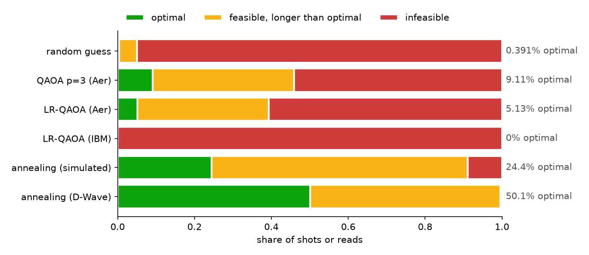

# Quantum applications

[](https://github.com/manavbabel/quantum-applications/actions/workflows/ci.yml)

This repo demonstrates quantum approaches to a series of problems, at present including industrial scheduling and sudoku, benchmarked against classical solvers. It is intended as an educational resource for those exploring quantum computing.

The results I've listed are derived from real QPUs, but if you wish to recreate them you will need to supply your own API keys.



*How various approaches perform at job shop scheduling.*

## Examples

| folder | problem | methods | status |
|---|---|---|---|
| [`job-shop-scheduling`](job-shop-scheduling) | schedule tasks on machines to finish as soon as possible | greedy, brute force, Gurobi, QAOA and LR-QAOA (simulated and IBM), annealing (simulated and D-Wave) | done |
| [`sudoku`](sudoku) | fill in a sudoku grid | exact simulation, simulated quantum annealing, D-Wave, and an [interactive demo](sudoku/demo) | done |
| unit commitment | decide which power stations to run | MAX-LINSAT with decoded quantum interferometry (DQI) | planned |
| finance | a problem still to be chosen | quantum-accelerated Monte Carlo (QCMC) | planned |

## What we've found so far

At sizes which can be simulated or run on real quantum devices, there is no evidence of any quantum advantage. Nevertheless, the quantum algorithms do work, consistently getting optimal solutions in noiseless simulation, and approaching that on real devices for smaller problems.

- Job shop scheduling: Gurobi ends up finding optima on every problem in under a millisecond. D-Wave's Advantage2 finds the optimum on 70%-100% of random problems of up to 8 tasks, and half of its reads on the 21-qubit example are optimal. IBM's circuits, at over 2,000 two-qubit gates, do worse than random guessing.
- Sudoku: D-Wave solves the 3x3 to 6x6 puzzles on nearly every read, but the easy 9x9 on only a handful of reads in 1,000. A hard 9x9 with 21 clues defeats every method here, simulated or real.

## Setup

With [uv](https://docs.astral.sh/uv/) installed, clone and run:

```
git clone https://github.com/manavbabel/quantum-applications.git
cd quantum-applications
uv sync
uv run pytest
```

Then open a notebook from its folder, for example:

```
cd sudoku
uv run jupyter lab sudoku.ipynb
```

- D-Wave (optional): a [Leap](https://cloud.dwavesys.com/leap/) account, then `uv run dwave setup` to save your API token.
- IBM Quantum (optional): an [IBM Quantum Platform](https://quantum.cloud.ibm.com/) account, then save your API key once with `QiskitRuntimeService.save_account(token=..., instance=...)`.

Feel free to run without the quantum accounts, everything automatically will run on local simulators as well. 

## Plans

I'm planning on completing the unit commitment and finance examples next. After that, the plan is to profile the Python and rewrite the slowest part in Rust with PyO3. Working notes are in [TODO.md](TODO.md).

## AI usage

I've found that AI very much follows the jagged frontier when it comes to quantum computing. The pace of the field, the rapidly changing SDKs, and the relative underspecification of a lot of algorithms mean that simply telling Claude to "solve job-shop scheduling with annealing" won't work as well as it could (although it will come up with a decent first try!) A fair amount of manual work is needed beforehand: defining the problem (as well as what is out of scope), formulating it properly, and designing the pipeline, before you can hand over the more boilerplate tasks.

In this repository, the problem definitions, formulations and pipelines were done manually. AI helped with boilerplate code (figures, basic data analysis, cloud access), the documentation and tidying up.

## Licence

[MIT](LICENSE)
