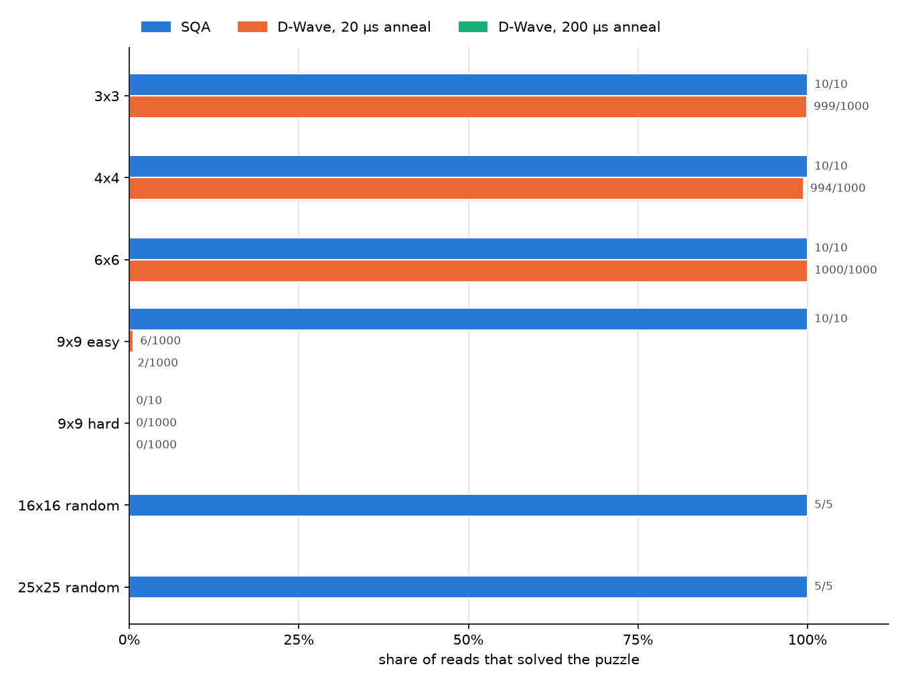

# Sudoku with quantum annealing

We write an n x n sudoku as a QUBO whose zero-energy states are exactly its solutions, then solve it by quantum annealing three ways: an exact simulation of the quantum dynamics, simulated quantum annealing (SQA), and D-Wave's Advantage2 quantum annealer.

There's also an [interactive demo](demo), built for a science festival stand, where visitors race a quantum annealer.



## Results

From the notebook's run on 16 October 2026:

| puzzle | blanks | qubits | SQA | D-Wave, 20 µs | D-Wave, 200 µs | qubits on the chip | longest chain |
|---|---|---|---|---|---|---|---|
| 3x3 | 8 | 20 | 10/10 | 999/1000 | | 26 | 2 |
| 4x4 | 12 | 26 | 10/10 | 994/1000 | | 34 | 2 |
| 6x6 | 22 | 46 | 10/10 | 1000/1000 | | 69 | 3 |
| 9x9 easy | 51 | 153 | 10/10 | 6/1000 | 2/1000 | 596 | 9 |
| 9x9 hard | 60 | 254 | 0/10 | 0/1000 | 0/1000 | 2,078 | 19 |
| 16x16 random | 128 | 445 | 5/5 | | | | |
| 25x25 random | 250 | 789 | 5/5 | | | | |

Each entry counts the reads that reached energy 0, a solved grid. The chip columns are for the 20 µs run. The exact simulation only fits the 3x3, and ends in one of its four solutions with probability 0.734.

- The encoding works: SQA solves every puzzle but one on every read, including random grids with hundreds of qubits.
- Difficulty depends more on a puzzle's structure than its size. The hard 9x9 (21 clues, a unique solution) defeats every method here, simulated or real.
- On D-Wave the small puzzles are solved on nearly every read, and the easy 9x9 is where it runs out. Its results also vary a lot between runs: an earlier run of the same cell, with a different embedding, solved 3 and 325 reads in 1,000.

## Running it

From this folder:

```
cd sudoku
uv run jupyter lab sudoku.ipynb
```

The D-Wave cell needs an account (see the [top-level README](../README.md)) and uses about 1.7 s of QPU time; set `use_dwave = False` to skip it. Everything else runs on a laptop in a few minutes, most of it the exact simulation.

Or use the modules directly:

```python
import numpy as np
from annealers import anneal_sqa
from sudoku import build_bqm, decode, fmt, is_solution, parse

np.random.seed(1)  # the simulators use numpy's global RNG
puzzle = parse(open("puzzles/6x6.txt").read())
sampleset = anneal_sqa(build_bqm(puzzle), stop_energy=0)
grid = decode(sampleset.first.sample, puzzle)
print(fmt(grid))
print(is_solution(grid, puzzle))
```

`anneal_statevector` takes the same BQM up to 20 qubits, and `anneal_qpu` sends it to D-Wave as one job of 1,000 reads.

Puzzle files have one row per line (or rows separated by `/`), with `.`, `0` or `_` for blanks, and whitespace-separated tokens when n > 9. Boxes are as square as possible (6x6 has 2x3 boxes), and a prime n has none, which makes a Latin square.

## How it works

There's one binary variable per blank cell and candidate value. Values already given in the cell's row, column or box are left out, which is the same as substituting the clues into the full QUBO; nothing further is worked out classically. Each rule says exactly one of a group of variables is set (one value per cell, and each missing value once per row, column and box), and adds the penalty (sum of the group - 1)^2. So a valid solution has energy 0, and every broken rule costs at least 1. `test_sudoku.py` checks this on every state of a small puzzle.

## Why annealing

Resources are for the easy 9x9.

| approach | resources | feasibility today | verdict |
|---|---|---|---|
| Grover search (gate model) | 204 data qubits (binary digits) plus an ancilla for each of 313 "not equal" checks, and about 10^11 oracle calls even after pruning | the oracle's multi-controlled gates need thousands of two-qubit gates, far beyond today's devices | a toy only; its quadratic speed-up is over brute force, which is the wrong baseline |
| QAOA or VQE (gate model) | 153 qubits and 650 ZZ terms per layer, from the same QUBO | routing on IBM's heavy-hex chips multiplies the depth, success falls exponentially with size on constrained problems, and over 20 qubits can't be simulated here | unlikely to work beyond the 3x3 |
| Gaussian boson sampling (photonic) | a solution is an independent set, the size of the blanks, in a 153-node conflict graph; samples of dense subgraphs seed a classical search | simulating it needs hafnians of about 51-photon states, and there's no public programmable device | a heuristic at best, with classical post-processing doing the work |
| Rydberg atoms (analogue) | the same conflict graph, which isn't unit-disk, so it needs gadgets with quadratic overhead | about 256 atoms, and no access here | promising natively, but too small once gadgets are added |
| quantum backtracking (fault-tolerant) | a near-quadratic speed-up over classical backtracking | needs error-corrected hardware | future work |
| quantum annealing (D-Wave) | 153 logical qubits, about 600 once embedded | 4,575-qubit Advantage2 available, and the QUBO runs natively | chosen |

We chose annealing because the QUBO runs on the hardware as it is, the qubit count grows only with the number of candidate values, hardware of the right size exists, and an energy of 0 proves a solution straight away.

## Files

| file | contents |
|---|---|
| `sudoku.ipynb` | the walkthrough and results |
| `sudoku.py` | parsing grids, the QUBO (`build_bqm`) and decoding samples back into grids |
| `annealers.py` | the three backends; each takes a dimod BQM and returns a dimod SampleSet |
| `puzzles/` | the example puzzles |
| `test_sudoku.py` | checks the encoding on every state of a small puzzle |
| `figures/` | the chart above, written by the notebook |
| `demo/` | the interactive demo; see [its README](demo/README.md) |

## Limits

- SQA is a classical Monte Carlo method that samples the annealer's quantum thermal state along the schedule. It doesn't simulate the real dynamics, and 16 Trotter slices is a coarse approximation. It's the usual stand-in for a quantum annealer at sizes a statevector can't reach, and says nothing about speed-up.
- On the QPU, the 9x9 is the practical ceiling: long chains and analogue noise make success rare above about 150 logical qubits. Puzzles as hard as the hard 9x9 need hybrid or classical solvers.
- The random puzzles are cleared at random from a valid grid, so they may have more than one solution.
