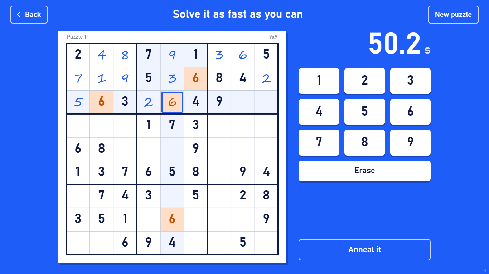
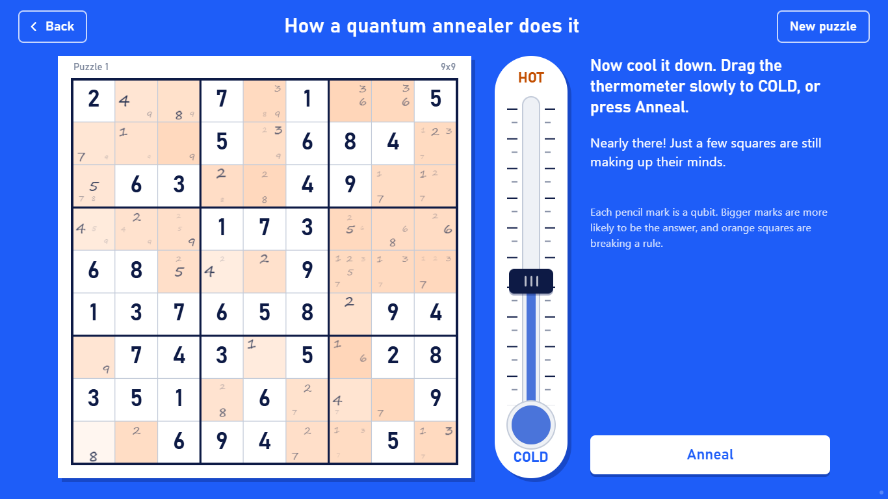
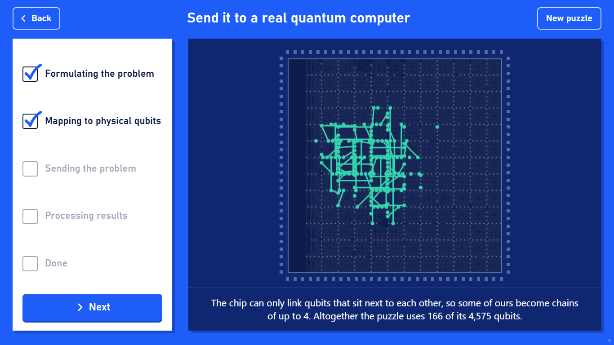

# Sudoku annealing demo

An interactive sudoku built for the NQCC stand at New Scientist Live. Visitors solve a puzzle against the clock, watch a simulated quantum annealer solve the same puzzle as they cool it down, then send it to D-Wave's Advantage2 quantum annealer.







## What visitors see

1. They pick a 4x4, 6x6 or 9x9 puzzle and solve it against the clock, then write their time on the board.
2. Every empty square is pencilled in with every number that could go there, and each pencil mark is a qubit. Dragging the thermometer from hot to cold plays back a recorded simulated quantum annealing run of that puzzle: the marks flicker while it's hot, and settle to one number per square as it cools.
3. The puzzle goes to a real quantum computer, one step per press of Next: its qubits and couplers, how they are laid out as chains on the chip, the fridge, a histogram of the 100 answers by rules broken, and the best answer. Nothing is sent to D-Wave until the visitor presses Send on the third step.

Each size has five puzzles with a unique solution. The 9x9s can all be solved by filling in squares that have only one possible number, so visitors don't need advanced techniques.

## Running it

The demo laptop needs Python 3.10 or later and nothing else (3.10 is the minimum for `dwave-cloud-client` 0.14.6).

```
cd quantum-applications/sudoku/demo
python setup_dwave.py
python serve.py
```

Run `setup_dwave.py` once, with internet, before the event. It creates `.venv` in this folder, installs `requirements.txt` into it, asks for the D-Wave API token (it's on the Leap dashboard) and saves it to `dwave.conf` here, then runs `python serve.py --check`. It's safe to re-run, and `python setup_dwave.py --token NEW_TOKEN` replaces the token. `dwave.conf` is git-ignored, and `serve.py` reads only that file, so the laptop's own D-Wave settings are neither used nor changed.

`serve.py` serves this folder at http://localhost:8765/ and opens it in the default browser. Press F11 for full screen, and Ctrl+C in the console to stop the server. It switches to `.venv` by itself, so there's nothing to activate. The console says whether D-Wave can be reached and prints one line per D-Wave job. `python serve.py --no-browser` starts the server without opening the page.

Opening `index.html` directly also works, but then the send step always shows the recorded results. Through `serve.py`, the recording is also shown whenever D-Wave can't be used: no token, no internet, no answer within 18 s, or any error.

## Notes for staff

- The small dot in the bottom-right corner shows where the last answer came from: filled for D-Wave, hollow for the recording.
- The page fits the screen from a 1366x768 laptop up to 1920x1080, and works by touch: long-presses don't open a menu, and pinch zoom is off.
- A URL hash jumps straight to any screen, which is handy for checking the page or taking screenshots; the options are at the top of `app.js`. For example, `index.html#size=9&puzzle=0&screen=anneal&t=0.5` opens the thermometer halfway down.

## If the check fails

`python serve.py --check` connects with `dwave.conf`, fetches the solver named in `data.js` (free; nothing is sent to the QPU) and checks that every qubit and coupler the puzzles use is still working. It prints `[OK]` or `[FAIL]` for each step and each puzzle size.

- can't connect: check the internet connection, then the token (`python setup_dwave.py --token NEW_TOKEN`)
- a mapping no longer fits, because D-Wave has taken qubits or couplers out of service: on a machine with the repo's uv environment, run `uv run python sudoku/demo/precompute.py` from the repo root, commit the new `data.js` and pull it onto the laptop

## Regenerating data.js

`data.js` holds the puzzles, the recorded annealing runs, the chip mappings and the fallback results. To rebuild it, from the repo root:

```
uv run python sudoku/demo/precompute.py
```

It fetches the working graph of `Advantage2_system1` from D-Wave (free), so it needs the D-Wave account set up for the repo (see the [top-level README](../../README.md)). `--solver NAME` maps the puzzles onto another QPU, and `--qpu-check` sends each stored problem to the QPU once (15 jobs of 100 reads, which uses QPU time).

## Files

| file | contents |
|---|---|
| `index.html`, `style.css`, `app.js` | the page, in plain HTML, CSS and JavaScript with no build step |
| `data.js` | the puzzles, recordings, chip mappings and fallback results, written by `precompute.py` |
| `serve.py` | the local server, which makes the live D-Wave call |
| `setup_dwave.py` | the one-off laptop setup |
| `precompute.py` | builds `data.js` |
| `test_demo.py`, `test_serve.py` | checks on `data.js` and on the server, run with `uv run pytest sudoku` |
